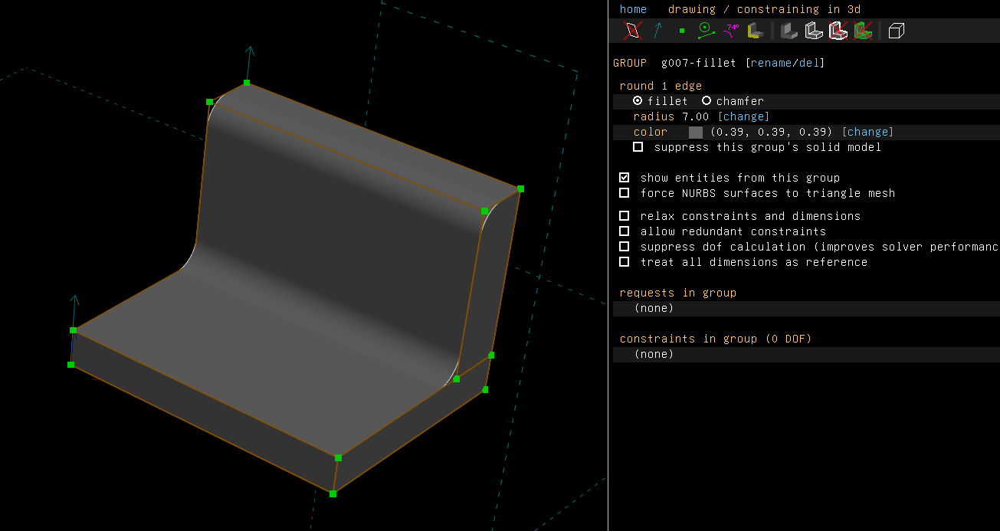
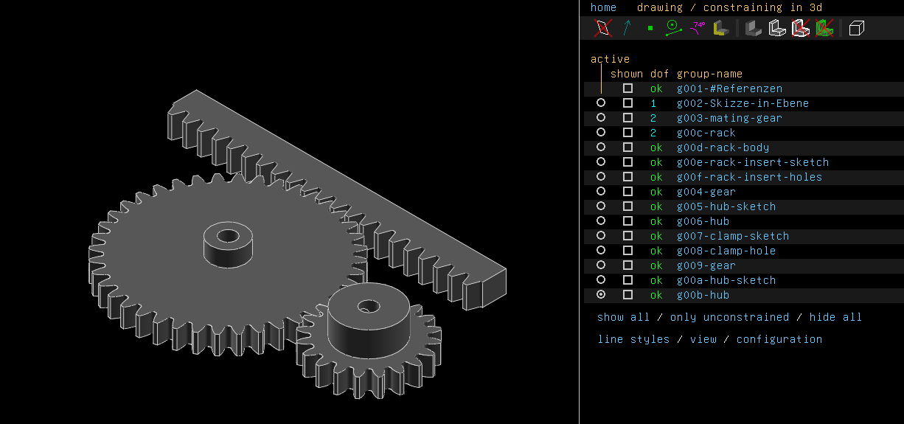
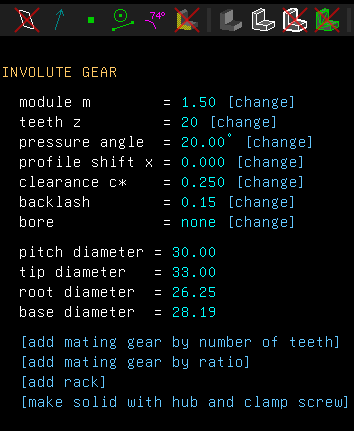

# SolveSpace – fork with fillets/chamfers and gear generator

This is an unofficial fork of [SolveSpace](https://github.com/solvespace/solvespace),
a parametric 2D/3D CAD tool. It adds two long-requested features: fillet and
chamfer edges, and an involute gear generator. The fork is not affiliated with
or supported by the SolveSpace maintainers. Please report bugs in these
features in this fork, not upstream.

## Fillet and chamfer edges



Straight edges between two plane faces of a solid can be rounded or beveled in
a separate group. The group offers a choice between fillet and chamfer and a
radius (fillet) or distance (chamfer) that can be changed at any time. The
result is a real NURBS solid, not just a triangle mesh.

## Involute gear generator





The gear dialog sets module, number of teeth, pressure angle, profile shift,
clearance, backlash and bore, and shows the resulting pitch, tip, root and base
diameters. From there a mating gear can be added by number of teeth or by
ratio, and a rack can be added. A gear can also be turned into a solid with a
hub and a clamp screw.

## Downloads

Binaries for Windows, macOS and Linux (Flatpak) are published on this fork's
[GitHub Releases page](https://github.com/joernfeuerabend/solvespace/releases).

The macOS DMG is unsigned. After the first launch attempt, allow the app under
System Settings -> Privacy & Security -> "Open Anyway", or run:

```sh
xattr -dr com.apple.quarantine /Applications/SolveSpace.app
```

The official packages (Flathub, Snap Store, upstream releases) contain upstream
SolveSpace without these features.

## Everything else

- Upstream repository and README (building on Linux, macOS, Windows and the
  web, contributing): https://github.com/solvespace/solvespace#readme
- Official website, tutorials, reference manual and forum: https://solvespace.com
- The upstream build instructions apply unchanged to this fork.

## License

SolveSpace is licensed under the GNU General Public License, version 3, like
upstream. See [COPYING.txt](COPYING.txt).
